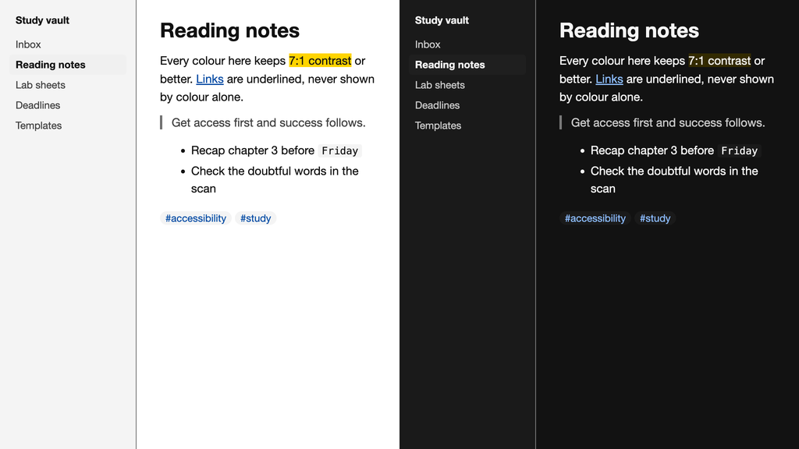

# Zacess for Obsidian

An Obsidian theme with Zacess Light for light mode and Zacess Dark for dark mode, plus the Yellow on
Black, Cream, High Contrast Dark and High Contrast Light themes through the Style Settings plugin.
Body text, muted text, links and code colours all keep at least 7:1 contrast. Links are underlined
and every control shows a focus ring.

The colours match the [Zacess](https://zacess.com) reader's contrast themes, so a page looks the
same in the reader and in your vault.

## Install

Open **Settings**, then **Appearance**, select **Manage** under **Themes**, search for **Zacess** and
select **Install and use**. Obsidian's own **Base color scheme** setting switches between Zacess
Light and Zacess Dark.

To install by hand, put `manifest.json` and `theme.css` from this repository in a folder named
`Zacess` inside your vault's `.obsidian/themes/` folder.

## Yellow on Black, Cream and the high contrast themes

Install the community plugin [Style Settings](https://github.com/mgmeyers/obsidian-style-settings),
open its settings and choose **Contrast theme** under **Zacess**. Yellow on Black, Cream, High
Contrast Dark and High Contrast Light replace both the light and the dark mode while they are
chosen.

## Releases

Each release here matches a release of [zacesshq/themes](https://github.com/zacesshq/themes) with
the same version and carries `manifest.json` and `theme.css`. The full notes for every version are
in its [changelog](https://github.com/zacesshq/themes/blob/main/CHANGELOG.md).

## Where the theme is made

> [!NOTE]
> This repository is a read-only copy for Obsidian's theme directory. The theme is generated from
> one palette in [zacesshq/themes](https://github.com/zacesshq/themes), which also has the same
> themes for VS Code, JetBrains IDEs, Neovim, Zed and terminals. Issues, ideas and pull requests go
> there.

## Licence

[MIT](LICENSE)
